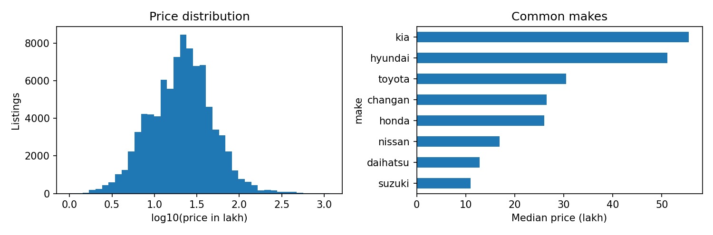
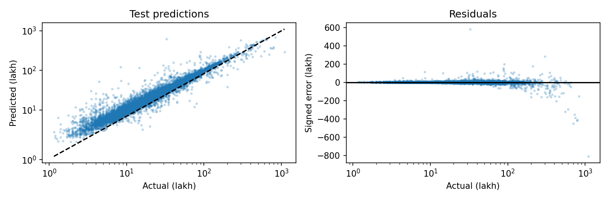

# PakWheels Used Car Price Prediction

A machine learning project that estimates used car asking prices in Pakistan using historical PakWheels listings. The aim is to understand which vehicle characteristics influence advertised prices and compare regression models on unseen data.

**Course:** CS4048 – Data Science | FAST-NUCES, Chiniot-Faisalabad Campus

## Project Overview

Buying or selling a used car can be difficult when there is no clear reference price. This project explores how information such as vehicle age, mileage, engine capacity, make, model and advertised features can help estimate a reasonable asking price. The workflow covers data cleaning, exploratory data analysis, feature engineering, model comparison and error analysis.

## Dataset

- Source: supplied `pakwheels.csv` (historical 2022 PakWheels listings)
- Original records: 89,956; columns: 17
- Cleaned records: 87,854
- Target: advertised asking price in lakh PKR (1 lakh = 100,000 PKR)
- Split: 52,712 training, 17,571 validation and 17,571 test records

Prices expressed in crore are converted to lakh. Listings without usable target prices are excluded. Missing values and inconsistent fields are handled during preprocessing. Seller descriptions are excluded to reduce the risk of target leakage.

## Methodology

1. Inspect and clean the dataset.
2. Explore price distributions, missing values and relationships between vehicle attributes.
3. Engineer features such as vehicle age, make, model and advertised feature count.
4. Compare regression models against a median-price baseline using a 60/20/20 split (random seed 42).
5. Compare basic, structured and full feature sets; select by validation MAE.
6. Refit the selected model on the combined training and validation data and evaluate on the untouched test set.
7. Perform three-fold cross-validation on development data, permutation feature importance and subgroup error analysis.

## Models Evaluated

- Linear Regression
- Ridge Regression
- Lasso Regression
- Elastic Net
- K-Nearest Neighbors
- Decision Tree
- Random Forest
- Extra Trees
- Gradient Boosting
- Histogram Gradient Boosting
- AdaBoost

A median-price baseline is included for comparison. SVM is excluded. Random Forest achieved the lowest validation MAE among the tested configurations.

## Final Results

**Selected model: Random Forest (full feature set)**

| Metric | Held-out test result |
| --- | ---: |
| R² | 0.8784 |
| Mean Absolute Error (MAE) | 3.06 lakh PKR |
| Root Mean Squared Error (RMSE) | 13.80 lakh PKR |
| Mean Absolute Percentage Error (MAPE) | 11.80% |

Three-fold development cross-validation MAE: **3.24 ± 0.07 lakh PKR** (mean ± population standard deviation).

The model explains approximately 87.84% of the variation in test asking prices. Its average absolute error is about PKR 305,812. The larger RMSE indicates that some predictions have substantial errors. Engine capacity, vehicle age, model, feature count and make were the leading predictive features in permutation importance analysis; this does not establish causation.

## Visualizations





## Repository Structure

```text
pakwheels-car-price-prediction/
├── Car_Price_Regression.ipynb
├── Project_Report.pdf
├── Final_Model_Summary.txt
├── Viva_Preparation.txt
├── README.md
├── requirements.txt
├── pakwheels.csv              # Supply locally if not published
└── results/
    ├── eda.png
    ├── test_plot.png
    ├── validation_scores.csv
    ├── feature_ablation.csv
    ├── importance.csv
    ├── errors_body_type.csv
    ├── errors_make.csv
    ├── errors_price_band.csv
    ├── test_predictions.csv
    ├── summary.json
    └── final_model.joblib
```

## Getting Started

Install Python (3.11 or newer recommended), then open a terminal in the repository folder:

```bash
python -m pip install -r requirements.txt
jupyter notebook Car_Price_Regression.ipynb
```

Place the supplied `pakwheels.csv` alongside the notebook. Select **Restart Kernel and Run All Cells** in Jupyter. The notebook saves outputs in `results/`. A CPU is sufficient; no GPU is required.

The saved joblib model expects engineered features, not raw advertisements. Follow the notebook's preprocessing and prediction workflow, including nonnegative prediction clipping. Only load trusted joblib files.

## Technologies Used

Python, NumPy, Pandas, Matplotlib, Scikit-learn, Joblib and Jupyter Notebook.

## Limitations and Future Work

The model predicts historical asking prices rather than confirmed sale prices or current market values. Vehicle condition, accident history and seller identity are not verified. Similar vehicles may occur across random splits, and rare or expensive cars can produce large errors. Fixed hyperparameters and ordinal category encoding also limit the comparison. Future work could use newer data, grouped or temporal splits, improved category encoding and systematic hyperparameter tuning.

## Academic and Data Usage

Developed as an academic mini project for CS4048 – Data Science. The supplied dataset is attributed to PakWheels. No redistribution license for the dataset has been established here. Before publishing a public repository, confirm permission to share the dataset and review any derived outputs for personal or identifying information. The project is intended for educational use, not as a live vehicle valuation service.
